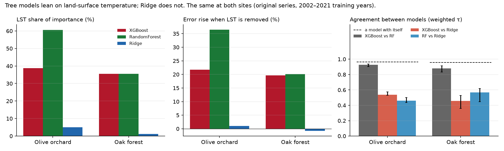
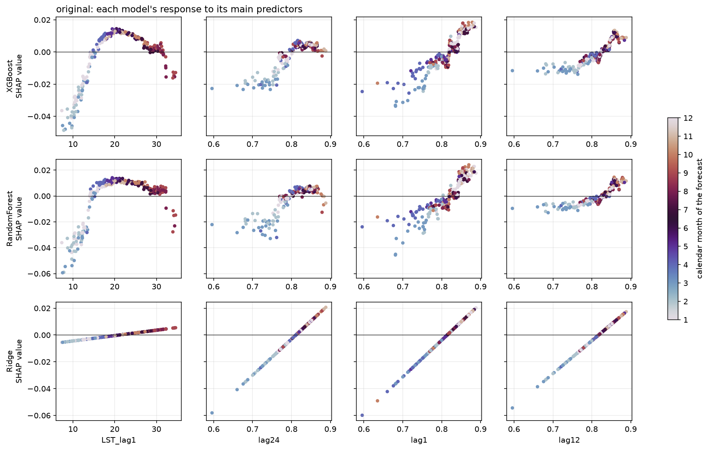

# forest-ndvi-xai-comparison

**Do different machine-learning models explain the same NDVI forecast the same way, and does
the answer change with the vegetation?**

XGBoost, Random Forest and Ridge regression forecast next month's NDVI from identical inputs
over an oak forest in the Kroumirie mountains (Jendouba, Tunisia). Their explanations are then
compared, each against how much it changes when the same model is simply refitted.

This is the **forest half** of a two-site study. The olive half is
[`olive-ndvi-xai-comparison`](https://github.com/ilyes-khayati/olive-ndvi-xai-comparison).
Notebooks 01–05 run the same code at both sites, so any difference between them comes from the
vegetation, not from the pipeline.



## Findings

- **The two tree models agree with each other; both disagree with Ridge.** Weighted Kendall τ
  between importance rankings is 0.88 for XGBoost vs Random Forest, and 0.46–0.57 for tree vs
  Ridge. Each model agrees with itself at 0.96 or more when refitted with other seeds.
- **The disagreement is land-surface temperature (LST).** A linear screen rejected LST (it adds
  nothing linear to NDVI's own history), and Ridge gives it about 1% of its importance. The
  tree models give it 36%, and refitting them without LST raises their error by 20%.
- **In the forest, the trees use LST as a seasonal clock.** Replacing LST by its monthly
  climatology keeps most of its value (+7–8% error instead of +20%). The trees respond to it
  through a threshold near 15 °C, where the canopy leaves its winter low.
- **In the olive orchard, the same predictor carries weather.** There the climatology alone
  recovers only 18–38% of LST's value, and the response steps down near 21 °C and 31 °C.

| Test 2022–2024 | XGBoost | Random Forest | Ridge | Climatology | Persistence |
|---|---|---|---|---|---|
| R² | 0.48 | 0.46 | 0.31 | 0.41 | −0.50 |
| MAE (NDVI) | 0.020 | 0.020 | 0.023 | 0.023 | 0.032 |

R² is modest because a closed canopy changes little (seasonal amplitude 0.13, against 0.43 in
the orchard), so noise is a large share of what is left to explain. In NDVI units the errors
are smaller than at the olive site.



*How each model responds to its main predictors. The trees bend LST into a threshold near 15 °C;
Ridge can only draw a straight line.*

## Study area

`forest-jendouba-polygon.geojson` is a 1 km² block centred at 36.7586 N, 8.7016 E.
Mean elevation is 740 m (SRTM), and ESA WorldCover v200 classes it as 100% tree cover.

- **NDVI** (MODIS, 250 m): the block holds 16 pixels' worth of area and touches 24.
- **LST** (MODIS, 1 km): it has the area of one pixel but straddles four, so LST includes some
  of the surrounding forest.
- Kroumirie holds both cork oak (evergreen) and zeen oak (deciduous). The persistent late-winter
  low in NDVI suggests a deciduous component; the species mix of the block is not yet confirmed.

## Protocol

| Step | Choice |
|---|---|
| NDVI quality | per-pixel `SummaryQA` = 0 only; a composite is dropped when fewer than half its pixels are good |
| Decomposition | discrete Meyer wavelet at native cadence (NDVI level 5, LST 6, SPEI 4): original, seasonal and trend branches |
| Own history | lasso with time-series CV and the one-standard-error rule; calendar given to every model on the original and seasonal branches |
| Lagged climate | LST and SPEI 1–48 at lags 1–12, kept when the correlation with the stage-1 residual passes a Bonferroni bound with effective sample size; at most one drought lag per branch |
| Probes | LST lag 1, kept although the linear screen rejects it; a Gaussian noise probe |
| Models | XGBoost, Random Forest, Ridge; randomised search (100 draws) or grid, on a five-fold `TimeSeriesSplit` |
| Evaluation | test 2022–2024, used once; 20-seed noise floor; five rolling windows, each tuned on its own training years |
| Attribution | out-of-fold permutation, drop-column, family permutation and SHAP; agreement by weighted Kendall τ against each model's agreement with itself |
| Mechanism | overlap of predictors with the calendar, clock-removal refits, LST climatology vs anomaly, SHAP dependence and interactions |

## Notebooks

| | Notebook | What it does |
|---|---|---|
| 01 | data acquisition | polygon extraction, per-pixel quality mask, SPEI 1–48 months |
| 02 | wavelet decomposition | discrete Meyer at native cadence; look-ahead of the trend measured |
| 03 | feature derivation | every predictor justified from evidence; a registry of decisions |
| 04 | model training | three models, baselines, noise floor, rolling origin |
| 05 | attribution | explanations across models, and what each model needs |

Each notebook writes to `data/processed/`, `results/` and `figures/`. The extracted series in
`data/raw/` are committed (about 200 KB), so notebooks 02–05 run without an Earth Engine
account. Every number above is in `results/`.

## Running it

```sh
git clone https://github.com/ilyes-khayati/forest-ndvi-xai-comparison.git
cd forest-ndvi-xai-comparison
python3.12 -m venv .venv && source .venv/bin/activate
pip install -r requirements.txt
python -m ipykernel install --user --name forest-xai
```

Open the notebooks with the `forest-xai` kernel and run 02 to 05 in order. Notebook 04 takes
about half an hour on a laptop, because each rolling window is tuned again; notebook 05 about
an hour. Notebook 01 re-extracts the data from Google Earth Engine and needs an account:

```sh
earthengine authenticate
export EE_PROJECT=<your Earth Engine project id>
```

## Limitations

- The trend branch is built by a two-sided filter, so its scores include look-ahead (measured
  in notebook 02). No forecasting claim is made on it.
- NDVI over a closed canopy is near saturation, so a large share of its month-to-month change
  is sensor and atmospheric noise.
- One forest block. The result is a case study until it is repeated on other blocks.

## Author

Ilyes Khayati. Data: MODIS MOD13Q1 and MOD11A2 (NASA LP DAAC, via Google Earth Engine),
SPEIbase v2.11, ESA WorldCover v200, SRTM.
